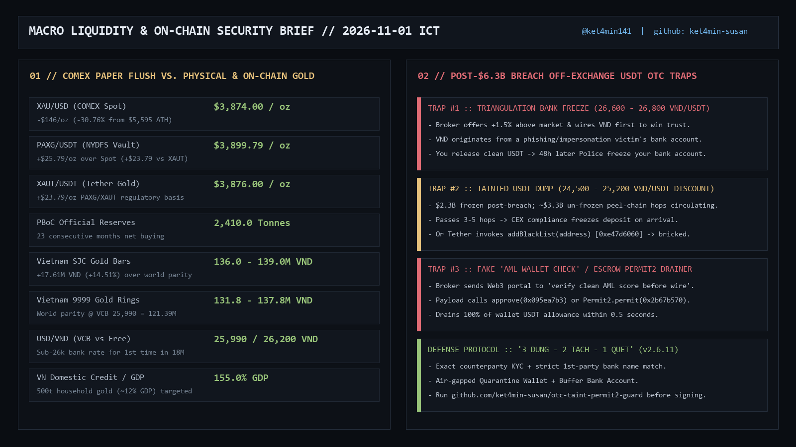

# `otc-taint-permit2-guard` (`v2.6.11`)

[](https://github.com/ket4min-susan/otc-taint-permit2-guard/actions/workflows/ci.yml) · **[Release `v2.6.11`](https://github.com/ket4min-susan/otc-taint-permit2-guard/releases/tag/v2.6.11)** · **[GitLab Mirror (`@memwm`)](https://gitlab.com/memwm/otc-taint-permit2-guard)**

Sub-second on-chain **USDT/USDC contract blacklist verifier** and **pre-sign EIP-712 `Permit2` / ERC20 allowance drainer calldata disassembler** for off-exchange OTC settlement.

See **[`RESEARCH_NOTE_2026_11.md`](./RESEARCH_NOTE_2026_11.md)** for the full technical analysis on multi-hop peel-chain taint propagation and malicious OTC escrow portals following the October 2026 `$6.3B` CEX breach.



## Core Capabilities

1. **Live Contract Storage Blacklist Verification (`Engine A`):**
   - Queries Ethereum Mainnet `USDT` (`0xdAC17F958D2ee523a2206206994597C13D831ec7`) selector `0xe47d6060` (`isBlackListed(address)`).
   - Queries Ethereum Mainnet `USDC` (`0xA0b86991c6218b36c1d19D4a2e9Eb0cE3606eB48`) and Base `USDC` (`0x833589fCD6eDb6E08f4c7C32D4f71b54bdA02913`) selector `0xfe575a87` (`isBlacklisted(address)`).
2. **Pre-Sign Calldata & Permit2 Tuple ABI Disassembler (`Engine B`):**
   - Decodes exact ABI spender word offsets across static and dynamic tuple layouts:
     - `Permit2.permit(address,PermitSingle,bytes)` (`0x2b67b570`): static tuple encoded in-place -> extracts `details.token` at `word 1` (`offset 0x24`) and `permitSingle.spender` at `word 5` (`offset 0xa4`).
     - `Permit2.permit(address,PermitBatch,bytes)` (`0x30f28b7a`): dynamic tuple via head offset pointer `0x60` at `word 1` -> extracts `permitBatch.spender` at `word 4` (`offset 0x84`).
     - `EIP-2612 permit(address,address,uint256,uint256,uint8,bytes32,bytes32)` (`0xd505accf`): extracts `spender` at `word 1` (`offset 0x24`).
     - `ERC20.approve` (`0x095ea7b3`), `increaseAllowance` (`0x39509351`), `increaseApproval` (`0xd73dd623`), `setApprovalForAll` (`0xa22cb465`): extracts `spender` at `word 0` (`offset 0x04`).

## Usage

```bash
python otc_taint_permit2_guard.py --selftest
python otc_taint_permit2_guard.py 0xCounterpartyOrDepositAddress
```
